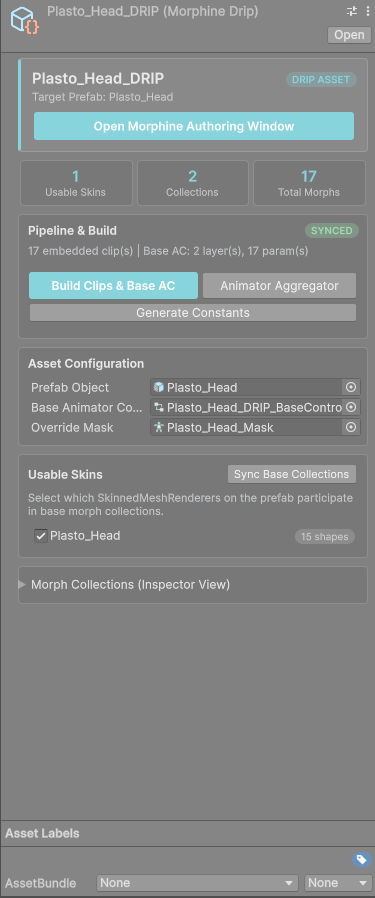

# Getting Started with Morphine

This guide walks through setting up your first **Morphine Drip** using the included **`Assets/Plasto_Head.prefab`** test character, inspecting it in Unity, and configuring the **`Morphine`** Editor layout for side-by-side live sculpting.

---

## Core Concepts

| Term | What It Is |
|---|---|
| **BlendShape** (`BlendShapeData`) | A single blend shape index on a specific `SkinnedMeshRenderer` (e.g., `Smile L` on `Plasto_Head`). |
| **Morph** | A named recipe mapping one or more `BlendShapeData` targets to authored base weights (`0–100`), identified by a stable internal GUID (`Id`). |
| **MorphCollection** | An ordered group of `Morph` objects (e.g., the auto-synced `Plasto_Head` base skin collection, or custom collections like `Expressions` or `Visemes`). Each collection has an `Include in Controller` toggle. |
| **MorphineDrip** | A self-contained `ScriptableObject` asset (`*_DRIP.asset`) that stores your prefab link, usable skins, morph collections, embedded morph `AnimationClip`s, embedded `AvatarMask`, and embedded Base `AnimatorController`. |
| **Base AnimatorController** | A morph-only `AnimatorController` stored as a sub-asset inside the `MorphineDrip`. Each included `MorphCollection` becomes an `Additive` layer (`weight = 1`) with a `Direct` BlendTree. |
| **Animator Aggregation Recipe** | An optional Editor-only asset (`AnimatorAggregationRecipe`) used by the standalone **Animator Aggregator** to non-destructively combine any number of project `AnimatorController`s and `MorphineDrip` assets into a single baked `.controller`. |

---

## Step 1: Create a Morphine Drip from `Plasto_Head.prefab`

1. In the **Project** window, locate **`Assets/Plasto_Head.prefab`**.
2. Right-click **`Plasto_Head.prefab`** and select **`Assets > Create > Animation > Morphine DRIP`**.
   - *(This menu item is enabled automatically whenever the selected prefab contains at least one `SkinnedMeshRenderer` with blend shapes.)*
3. Morphine creates **`Assets/Plasto_Head_DRIP.asset`** beside the prefab and automatically:
   - Embeds an `AvatarMask` sub-asset (`Plasto_Head`) with all Humanoid body parts disabled and an empty transform list (ensuring bones are masked out while blend shape curves evaluate cleanly).
   - Populates **Usable Skins** with all blend-shape-bearing `SkinnedMeshRenderer`s found on the prefab (`Plasto_Head`, 15 blend shapes).
   - Generates an initial **Base Collection** (`Plasto_Head`) containing 15 single-target morphs (`Mouth closed`, `Mouth open wide`, `ooh`, `Smile R`, `Smile L`, `Sad R`, `Sad L`, `Sneer R`, `Sneer L`, `Cheek R Puff `, `Cheek L Puff `, `Brow R down`, `Brow R up`, `Brow L down`, `Brow L up`).

---

## Step 2: Inspect `Plasto_Head_DRIP.asset`

Select **`Plasto_Head_DRIP.asset`** in the Project window to view the custom **`MorphineDripEditor`** Inspector:

### Inspector Sections
- **Header & Launch CTA**: Displays the target prefab and the primary **Open Morphine Authoring Window** button (double-clicking the DRIP asset in the Project window opens the same workspace).
- **Validation Container**: Automatically flags missing prefabs, unselected usable skins, unsynced base collections, or broken blend shape indices if the source mesh changes.
- **Quick Stats**: Shows live counts of **Usable Skins**, **Collections**, and **Total Morphs**.
- **Pipeline & Build**: Shows the live build badge (`SYNCED` or `NEEDS BUILD`), embedded clip count, Base AC layer/parameter counts, and 1-click buttons for **Build Clips & Base AC**, **Animator Aggregator**, and **Generate Constants**.
- **Asset Configuration**: Displays `Prefab Object`, the embedded `Base Animator Controller`, and the embedded `Override Mask`.
- **Usable Skins**: Toggle which `SkinnedMeshRenderer`s on multi-mesh characters (e.g., head, eyebrows, teeth, eyelashes) participate in base collections. Click **Sync Base Collections** after importing updated meshes—existing custom collections are preserved non-destructively.

---

## Step 3: Switch to the `Morphine` Editor Layout

Morphine works best when you can sculpt sliders and watch your character deform in real time:

1. In Unity's top-right layout dropdown (or **`Window > Layouts > Morphine`**), select the **`Morphine`** layout.
2. This docks the **Morphine Authoring Window** directly next to the **Scene View** so opening a Drip in Prefab Stage gives an immediate split-screen sculpting workspace.

Next: [Authoring Morphs →](02-Authoring-Morphs.md)
