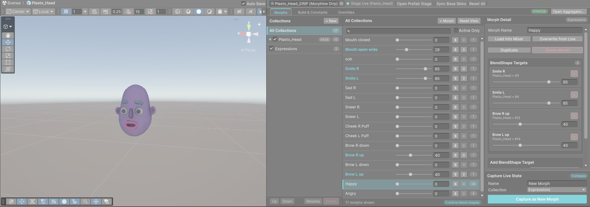
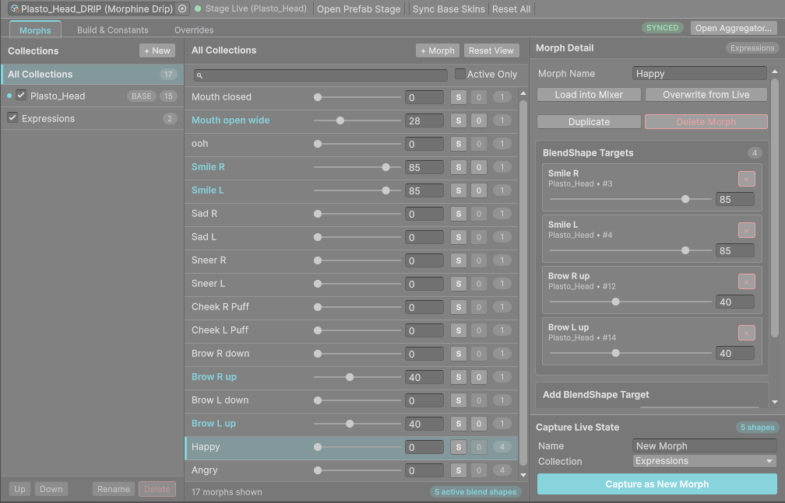

# Authoring Morphs

The **Morphine Authoring Window** (`Tools > Morphine > Authoring Window`, or double-click any `MorphineDrip` asset) provides a non-destructive 3-pane workspace bound directly to Unity's **Prefab Stage**.

---

## Top Toolbar & Mode Tabs

- **Drip Selector**: Switch active `MorphineDrip` assets at any time.
- **Stage Status Indicator**:
  - **Green (`Stage Live`)**: Connected to the prefab's open Prefab Stage. Slider edits update the mesh live without dirtying your prefab asset; closing the window or Prefab Stage automatically restores resting blend shape weights.
  - **Amber (`Stage Disconnected`)**: Click **Open Prefab Stage** to bind live preview.
- **Mode Tabs**: Switch between **Morphs** (live sculpting), **Build & Constants** (clip & Base AC baking), and **Overrides** (cross-character `AnimatorOverrideController` mapping).
- **Quick Pipeline Bar**: Displays the live `SYNCED` / `NEEDS BUILD` status badge and an **Open Aggregator...** shortcut to launch the standalone Animator Aggregator pre-loaded with this Drip.

---

## The 3-Pane Authoring Workspace

### 1. Left Pane — Collections
- **All Collections**: Displays every morph across all collections in the center mixer.
- **`Include in Controller` Checkbox**: Each collection row has a checkbox controlling `MorphCollection.includeInController`. Uncheck a collection (for example, the raw `Plasto_Head` `BASE` collection if you only want custom recipes exported) to exclude it from the embedded Base `AnimatorController`.
- **Active Dot**: A teal dot lights up beside any collection that currently has non-zero preview sliders.
- **Footer Actions**: Reorder collections (`Up` / `Down`), double-click or click **Rename**, click **+ New** for custom collections, or **Delete** with confirmation.

### 2. Center Pane — Virtualized Morph Mixer
- **Additive Live Evaluation**: Move multiple sliders simultaneously (`0–100`); Morphine sums overlapping blend shape contributions across all active morphs and clamps each target to `[0, 100]` on the Prefab Stage instance.
- **Solo (`S`)**: Isolate a single morph immediately (the top toolbar shows an amber `SOLO: <Name> ×` banner). Click `S` again or the banner to return to full additive mixing.
- **Reset (`0`)**: Zero an individual morph, click **Reset View** to zero the current collection, or **Reset All** in the top toolbar.
- **Search & `Active Only`**: Filter large facial rigs (e.g., ARKit 52+ shapes) by morph/collection name or show only morphs currently above `0`.

### 3. Right Pane — Morph Detail & Capture

#### Walkthrough: Sculpting & Capturing Custom Expressions on `Plasto_Head`

1. In the **Morphs** tab with `Plasto_Head` live in Prefab Stage, dial the base sliders in the Center Pane:
   - `Smile L` → **`85`**
   - `Smile R` → **`85`**
   - `Brow L up` → **`40`**
   - `Brow R up` → **`40`**
   - Notice the **Capture Live State** badge updates to **`4 shapes`**.
2. In the bottom **Capture Live State** panel:
   - Set **Name** to **`Happy`**.
   - Set **Collection** to **`+ New Custom Collection...`** (or select an existing custom collection such as `Expressions`).
   - Click **Capture as New Morph**. Morphine records all active evaluated blend shape weights into the new morph (with full Unity `Undo`/`Redo` support).
3. Click **Reset All**, then sculpt a second expression:
   - `Sneer L` → **`70`**, `Sneer R` → **`70`**, `Brow L down` → **`90`**, `Brow R down` → **`90`**.
   - Capture as **`Angry`** into **`Expressions`**.

#### Refining an Existing Morph
Select **`Happy`** in the mixer to inspect it in the **Morph Detail** pane:
- **Load into Mixer**: Decomposes `Happy` back into its individual base blend shape sliders so you can tweak `Smile L`/`Smile R` or add `Mouth open wide = 35` interactively in the Scene View.
- **Overwrite from Live**: Replaces `Happy`'s targets with the current live evaluated preview state (with confirmation).
- **Direct Target Editing**: Adjust any constituent target's slider (`0–100`), remove targets (`×`), or use **Add BlendShape Target** to pick a Skin, BlendShape, and Base Weight directly.
- **Duplicate / Delete / Rename**: Full Undo-safe operations. Renaming a morph preserves its internal stable ID so its embedded `AnimationClip` updates in-place on the next build.

Next: [Building Clips & Base Controller →](03-Building-Clips-and-Base-Controller.md)
