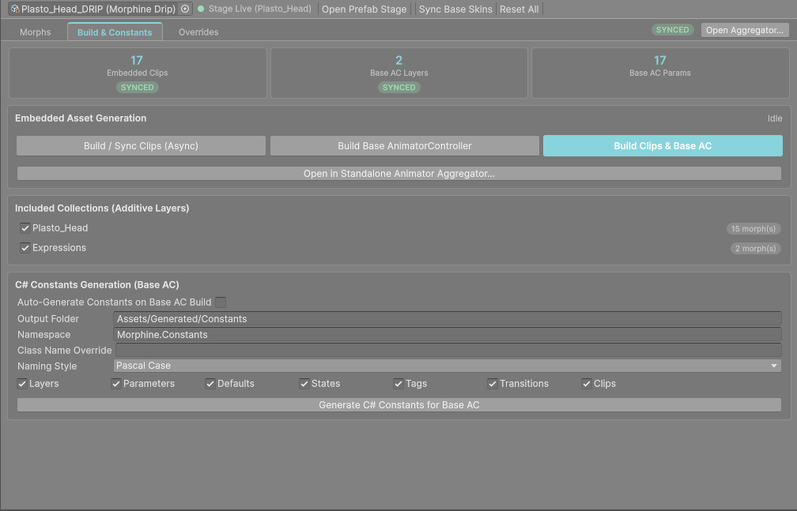

# Building Clips & Base AnimatorController

Once your morph recipes are authored, switch to the **Build & Constants** tab in the **Morphine Authoring Window** (or use the **Pipeline & Build** card in the `MorphineDrip` Inspector) to bake embedded `AnimationClip`s and the embedded Base `AnimatorController`.

---

## Embedded Morph `AnimationClip` Storage

All generated `AnimationClip`s are embedded directly as sub-assets inside your `*_DRIP.asset` file (e.g., `Plasto_Head_DRIP.asset`) rather than scattered across project folders:

- **Zero Folder Clutter**: One self-contained `.asset` file holds your morph data, clips, `AvatarMask`, and Base `AnimatorController`.
- **Full Runtime Referencing**: Unity references embedded sub-assets by `(GUID, fileID)` identically to standalone `.anim` files, so `AnimatorController`s, `AnimatorOverrideController`s, Timelines, and runtime scripts work seamlessly in Player builds.
- **Authored Target Weights**: Each clip bakes 1-frame constant pose curves (`t = 0`) using every target's exact authored weight (e.g., `Happy` bakes `Smile L = 85`, `Smile R = 85`, `Brow L up = 40`, `Brow R up = 40`). In a Direct BlendTree, driving the `Happy` Float parameter from `0.0` to `1.0` scales the entire recipe proportionally from `0%` to `100%`.
- **Collision-Free Naming**: Unique morph names use `<Morph>` (e.g., `Happy`); if two collections share a morph name, Morphine disambiguates them as `<Collection>_<Morph>`.

---

## Incremental In-Place Sync & Non-Blocking Async Builds

Morphine tracks every morph via its stable internal GUID (`Morph.Id`) and a SHA-256 content hash (`MorphClipBinding.contentHash`):

- **Rename & Edit Safe**: Renaming a morph or editing its target weights updates the **existing** embedded `AnimationClip` sub-asset **in-place**, preserving its `fileID` so external AnimatorControllers and OverrideControllers never lose references.
- **Automatic Orphan Pruning**: Deleting a morph from a collection removes its orphaned `AnimationClip` sub-asset cleanly on the next sync.
- **Non-Blocking Editor Execution**: Because Unity's `AnimationClip` and `AssetDatabase` APIs are main-thread-only, **Build / Sync Clips (Async)** and **Build Clips & Base AC** run time-sliced on the main thread (~8 ms frame budget via `EditorApplication.update`), display progress in Unity's bottom-right **Background Tasks** (`UnityEditor.Progress`) bar, support **Cancel**, and flush all sub-asset changes in a single batched `AssetDatabase.StartAssetEditing()` / `StopAssetEditing()` + `AssetDatabase.SaveAssets()` call.

---

## Embedded Base `AnimatorController`

Clicking **Build Base AnimatorController** or **Build Clips & Base AC** creates (or updates in-place) `<DripName>_BaseController` as a sub-asset inside `Plasto_Head_DRIP.asset`:

1. **Per-Collection Additive Layers**: Every `MorphCollection` with `Include in Controller` checked generates one layer configured with:
   - `Blending = Additive`
   - `Default Weight = 1.0`
   - `AvatarMask = drip.overrideMask` (all Humanoid body parts disabled, transform mask empty so blend shape curves evaluate while bones remain masked)
2. **Direct BlendTrees**: Each layer contains a single default state holding a `Direct` BlendTree (`useAutomaticThresholds = false`) wired to that collection's embedded morph clips and unique `Float` parameters.
3. **Zero-Pose `additiveReferencePoseClip` (Why Additive Layers Sum Accurately)**:
   - Unity Mecanim evaluates Additive layers as $\text{clip}(t) - \text{refPose}(0)$. Without an explicit reference pose clip, a 1-frame clip subtracts frame 0 from itself ($\text{weight} - \text{weight} = 0$).
   - Morphine automatically maintains a hidden embedded zero-pose clip (`__Morphine_Empty`) containing `0f` curves for every blend shape on your prefab and binds it as every morph clip's `additiveReferencePoseClip`.
   - As a result, driving `Smile L = 0.5` on the `Plasto_Head` layer and `Happy = 1.0` on the `Expressions` layer cleanly sums their blend shape contributions additively—both standalone and after aggregation!

### Build Tab Actions

| Button | Behavior |
|---|---|
| **Build / Sync Clips (Async)** | Incrementally syncs embedded morph clips and `__Morphine_Empty` without touching the Base AC. |
| **Build Base AnimatorController** | Rebuilds the embedded Base AC in-place using the currently generated clips. |
| **Build Clips & Base AC** | Runs async clip sync followed by Base AC rebuild (and automatically regenerates C# Constants if **Auto-Generate Constants on Base AC Build** is checked). |
| **Open in Standalone Animator Aggregator...** | Opens `Tools > Morphine > Animator Aggregator` pre-loaded with this Drip (or its linked `AnimatorAggregationRecipe`). |

Next: [Animator Aggregation →](04-Animator-Aggregation.md)
