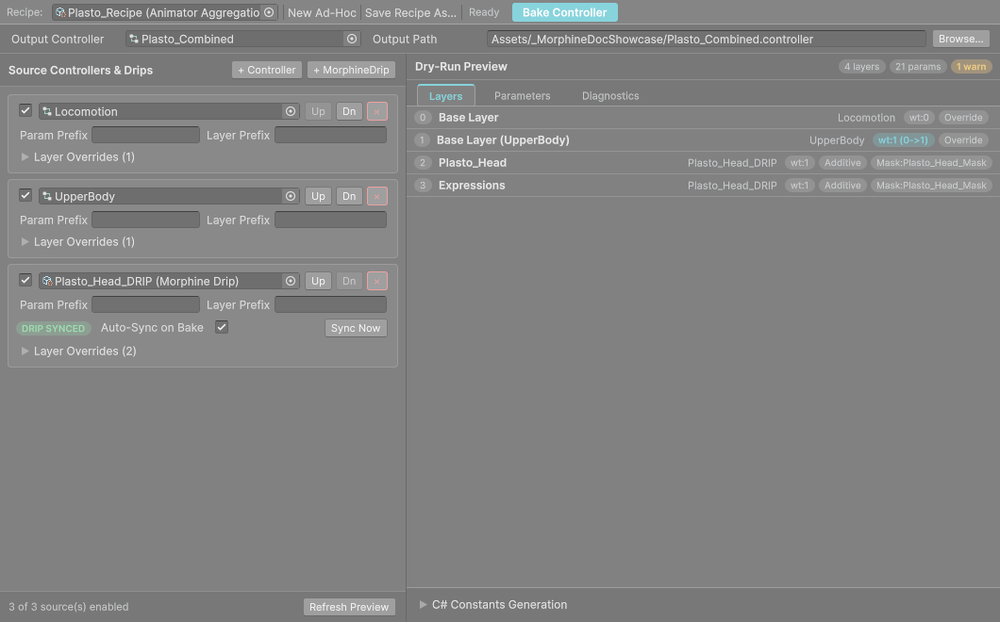
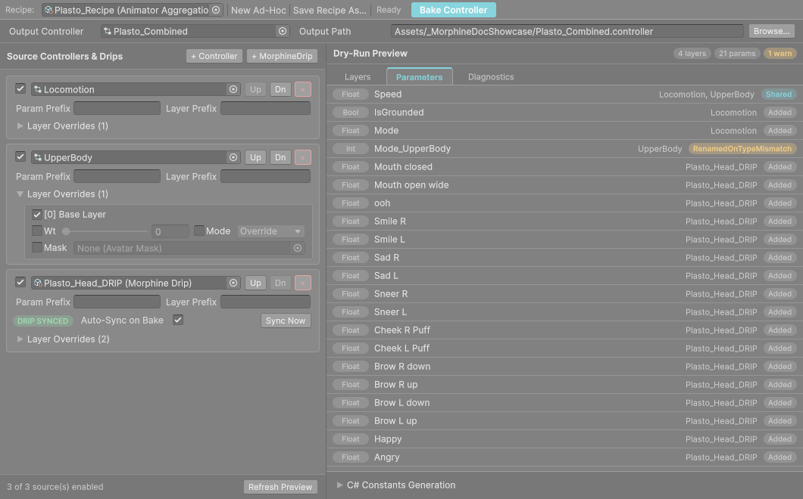

# AnimatorController Aggregation

The standalone **Animator Aggregator** (`Tools > Morphine > Animator Aggregator`) combines any ordered list of Unity `AnimatorController` assets and `MorphineDrip` assets into a single baked `.controller` asset—non-destructively and **without requiring a `MorphineDrip`** (you can use it to merge Locomotion, UpperBody, Combat, IK, or facial controllers in any combination).

---

## Ad-Hoc Mode vs. Saved Recipes

- **Ad-Hoc Mode**: Open `Tools > Morphine > Animator Aggregator`, add controllers/Drips, set an output path, and click **Bake Controller** immediately—no extra asset required.
- **Reusable Recipe (`AnimatorAggregationRecipe`)**: Click **Save Recipe As...** (or create via `Assets > Create > Morphine > Animator Aggregation Recipe`) to save your source list, prefixes, layer overrides, output controller target, and C# Constants config into an **Editor-only `ScriptableObject`**.
  - Double-clicking a Recipe asset in the Project window opens it directly in the Animator Aggregator.
  - Because `AnimatorAggregationRecipe` lives in `Anodyne.Morphine.Editor`, references to your source controllers never leak into Player builds.

---

## Configuring Sources & Layer Overrides

Click **+ Controller** or **+ MorphineDrip** in the **Source Controllers & Drips** pane (or launch via **Open Aggregator...** from any Drip). Sources evaluate top-to-bottom:

- **Enable Toggle & Order (`Up` / `Dn` / `×`)**: Reorder sources to control the final layer stack (typically placing `MorphineDrip` sources last so their `Additive` morph layers evaluate on top of locomotion/body layers).
- **`Param Prefix` & `Layer Prefix`**: Optionally isolate a source's parameters or layers (e.g., prefixing `Hero_` automatically remaps every transition condition, BlendTree parameter, and state parameter property inside that source's cloned layers).
- **MorphineDrip Auto-Sync**: For `MorphineDrip` sources, a live badge shows `DRIP SYNCED`, `DRIP DIRTY`, or `NO BASE AC`. Keep **Auto-Sync on Bake** checked (or click **Sync Now**) to guarantee the Drip's clips and embedded Base AC are current before baking.
- **Expandable `Layer Overrides`**: Expand any source card's **Layer Overrides** foldout to toggle individual layers (`include`), override layer **Weight** (`Wt`), override **Blending Mode** (`Override` / `Additive`), or override **AvatarMask** without modifying the source controller.

---

## Understanding the Live Dry-Run Preview

Before any file is modified, the right-hand **Dry-Run Preview** runs `AnimatorAggregationPlanner` in real time:

### Layers Tab
- **Unique Layer Naming**: Duplicate layer names (such as every controller having `"Base Layer"`) are automatically disambiguated (e.g., `Base Layer (UpperBody)`).
- **Layer 0 `0 -> 1` Weight Promotion**: Standalone Unity `AnimatorController`s often serialize Layer 0 with `defaultWeight = 0` (Unity ignores weight on index 0). Whenever a source controller's Layer 0 lands at target index `> 0` with `weight == 0`, the Aggregator automatically promotes it to **`wt:1 (0->1)`** so the layer actually evaluates at runtime unless you explicitly override its weight.
- **Synced Layers (`Sync->N`)**: Synced layer indices and per-state override motions/behaviours are remapped automatically to their source's new layer indices.

### Parameters Tab
- **`Added`**: Standard parameter copied with its default value.
- **`Shared`** (teal): Two or more controllers define the same parameter name with the **same type** (e.g., `Float Speed` in both `Locomotion` and `UpperBody`). They merge into one shared runtime parameter so setting `Speed` once drives both layers.
- **`Prefixed`**: Isolated by a source's `Param Prefix`.
- **`RenamedOnTypeMismatch`** (amber warning): Two controllers define the same name with **different types** (e.g., `Float Mode` in `Locomotion` vs. `Int Mode` in `UpperBody`). Morphine automatically renames the conflicting parameter (e.g., `Mode_UpperBody`), remaps every transition condition, BlendTree parameter, and state parameter field in that controller's cloned layers, and logs a warning in **Diagnostics**.

### Diagnostics Tab
Lists all errors, warnings (such as type mismatches or excluded sync targets), and informational notices (layer renames, Layer 0 weight promotions).

---

## Non-Destructive In-Place Baking

Click **Bake Controller** to deep-clone all enabled sources into the **Output Controller**:

- If the output `.controller` already exists, Morphine clears and rebuilds its internal graph **in-place**, preserving its asset **GUID** so all character prefabs, scenes, and `AnimatorOverrideController`s referencing it stay intact.
- Deep-cloned elements include: Layers, StateMachines, nested SubStateMachines, States (and all parameter-driven properties), nested 1D/2D/Direct BlendTrees, Entry/Exit/AnyState/State/SubSM Transitions, `StateMachineBehaviour` instances (preserving serialized field values), and Synced Layer overrides. Leaf `AnimationClip` references are shared directly.
- Expand **C# Constants Generation** at the bottom of the right pane and enable **Auto-Generate on Bake** to keep your runtime C# constants file synchronized automatically on every bake.

Next: [Animator Overrides →](05-Animator-Overrides.md)
