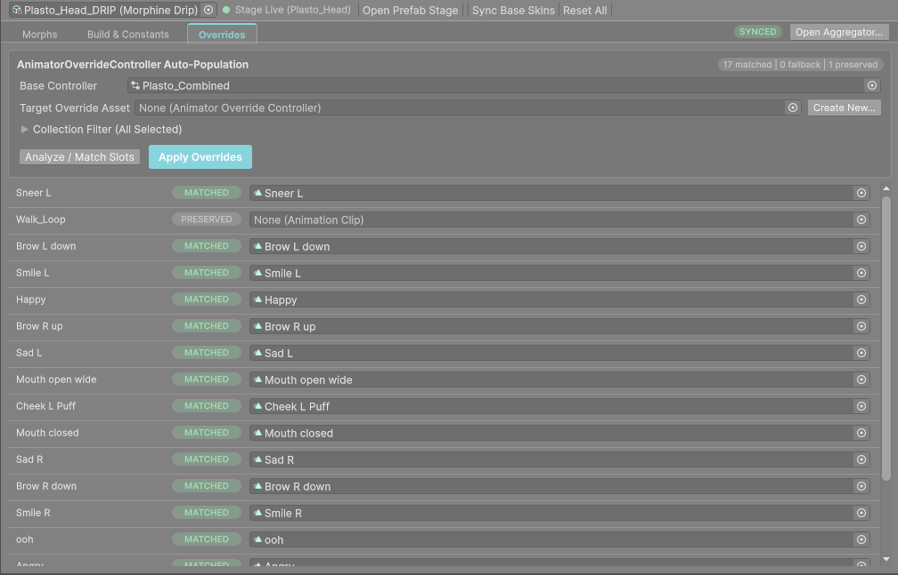

# Cross-Character Animator Overrides

When multiple characters share the same expression vocabulary (e.g., `Happy`, `Angry`, `Smile L`, `Smile R`, or ARKit visemes) but have different meshes, transform paths, or blend shape indices, you do **not** need to duplicate your entire Aggregated `AnimatorController` per character.

Instead, build **one master Aggregated `AnimatorController`** and use Morphine's **Overrides** tab to auto-populate a lightweight `AnimatorOverrideController` for each character's `MorphineDrip`.

---

## Step-by-Step Workflow

1. Open the target character's `MorphineDrip` (e.g., `CharacterB_DRIP` or `Plasto_Head_DRIP`) in **Morphine Authoring Window** and select the **Overrides** tab.
2. Assign your master controller (such as `Plasto_Combined.controller` or Character A's Base AC) to **Base Controller**.
3. Assign an existing `AnimatorOverrideController` to **Target Override Asset**, or click **Create New...** to create one on disk.
4. *(Optional)* Expand **Collection Filter** to restrict matching to specific `MorphCollection`s (for instance, matching only `Expressions` while ignoring raw base skin collections).
5. Click **Analyze / Match Slots** to preview the mapping, review or tweak individual slots, and click **Apply Overrides**.

---

## Understanding Slot Status Badges

Morphine inspects every overridable clip slot in the base controller and classifies it automatically:

| Badge | Meaning | Behavior on Apply |
|---|---|---|
| **`MATCHED`** (green) | Found a matching morph clip in the target Drip (matched by clip name, `<Collection>_<Morph>`, `<Morph>`, or stripped collection prefix). | Overrides the slot with the target Drip's embedded morph `AnimationClip`. |
| **`FALLBACK`** (amber) | Slot is a morph blend shape clip, but the target Drip has no matching morph. | Maps the slot to the target Drip's embedded zero-pose **`__Morphine_Empty`** clip so the missing morph cleanly contributes `0` weight instead of falling back to Character A's curves. |
| **`PRESERVED`** (neutral) | Slot is a non-morph animation (e.g., `Walk_Loop`, skeletal/transform body animation). | Leaves the override as `None` so the base controller's original locomotion animation plays untouched. |
| **`MANUAL`** (teal) | You manually changed the slot's `AnimationClip` `ObjectField` in the review table. | Applies your chosen clip verbatim. |

---

## Unity `AnimatorOverrideController` Limitations

Keep these engine constraints in mind when designing a shared master controller:

- **Clip Swaps Only**: An `AnimatorOverrideController` can only replace `AnimationClip` references—it **cannot** add or remove parameters, add layers, or add/remove Direct BlendTree children.
- **Unique Slot Clips**: Every morph slot in the master controller must use a distinct `AnimationClip` asset (which Morphine guarantees automatically because every morph owns its own embedded sub-asset clip).
- **Superset Master**: Any morph that Character B has *in addition* to the master controller will not appear unless it has a slot in the master controller.

Next: [Constants & Runtime Playback →](06-Constants-and-Runtime-Playback.md)
