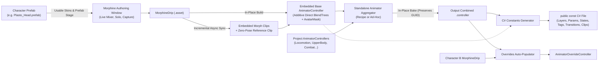

# Morphine Documentation

**Morphine** streamlines authoring, baking, aggregating, and driving `SkinnedMeshRenderer` blend shape rigs in Unity 6. It centers on the **`MorphineDrip`** asset—a self-contained `ScriptableObject` holding your morph recipes, embedded `AnimationClip` sub-assets, embedded `AvatarMask`, and embedded Base `AnimatorController`—paired with a standalone **Animator Aggregator** and compile-time **C# Constants Generator**.

---

## Architecture at a Glance

---

## Feature Matrix

| Capability | Entry Point | Output / Storage |
|---|---|---|
| **Create Drip from Prefab** | Right-click Prefab → `Assets > Create > Animation > Morphine DRIP` | `<Prefab>_DRIP.asset` + embedded `AvatarMask` |
| **Live Morph Authoring** | Double-click Drip or `Tools > Morphine > Authoring Window` (`Morphs` tab) | Non-destructive Prefab Stage preview + `MorphCollection` recipes |
| **Morph Clip & Base AC Build** | Authoring Window (`Build & Constants` tab) or Inspector quick actions | Embedded `AnimationClip`s, `__Morphine_Empty` zero-pose clip, & embedded Base `AnimatorController` |
| **AnimatorController Aggregation** | `Tools > Morphine > Animator Aggregator` (or **Open Aggregator...** from a Drip) | Dedicated baked `.controller` (updated in-place) + optional Editor-only `AnimatorAggregationRecipe` |
| **Cross-Character Overrides** | Authoring Window (`Overrides` tab) | Populated `.overrideController` with fallback & locomotion preservation |
| **C# Constants Generation** | Build tab, Aggregator (`Auto-Generate on Bake`), Inspector, or `Assets > Create > Animation > Animator Controller C# Constants` | Compile-time `public const` `.cs` file |

---

## User Guide

A step-by-step walkthrough built around **`Assets/Plasto_Head.prefab`** and the docked **`Morphine`** Unity Editor layout:

1. [Getting Started](UserGuide/01-Getting-Started.md) — Core concepts, creating `Plasto_Head_DRIP`, Inspector overview, and the `Morphine` Editor layout
2. [Authoring Morphs](UserGuide/02-Authoring-Morphs.md) — Live Prefab Stage sculpting, Collections, Mixer, Solo, Search/Active-Only, Capture & Overwrite
3. [Building Clips & Base Controller](UserGuide/03-Building-Clips-and-Base-Controller.md) — Embedded sub-asset clips, incremental async sync, zero-pose additive reference, and Base `AnimatorController`
4. [Animator Aggregation](UserGuide/04-Animator-Aggregation.md) — Standalone Animator Aggregator, Recipes vs Ad-Hoc, layer overrides, collision rules, and live Dry-Run Preview
5. [Animator Overrides](UserGuide/05-Animator-Overrides.md) — Cross-character `AnimatorOverrideController` auto-population, slot statuses, and Unity limitations
6. [Constants & Runtime Playback](UserGuide/06-Constants-and-Runtime-Playback.md) — Configuring C# Constants, identifier sanitization, and driving morphs cleanly at runtime
7. [Troubleshooting & Best Practices](UserGuide/07-Troubleshooting-and-Best-Practices.md) — Unity 6 Mecanim rules, `AvatarMask` pitfalls, culling, and build hygiene

---

## Scripting API Reference

Complete reference organized by namespace:

- **[Scripting API Index](ScriptingAPI/Index.md)**
- **Runtime (`Anodyne.Morphine`)**:
  - [MorphineDrip](ScriptingAPI/Runtime/MorphineDrip.md)
  - [MorphCollection](ScriptingAPI/Runtime/MorphCollection.md)
  - [Morph](ScriptingAPI/Runtime/Morph.md)
  - [BlendShapeData](ScriptingAPI/Runtime/BlendShapeData.md)
  - [MorphClipBinding](ScriptingAPI/Runtime/MorphClipBinding.md)
  - [MorphineConstantsConfig](ScriptingAPI/Runtime/MorphineConstantsConfig.md)
- **Editor (`Anodyne.Morphine.Editor.*`)**:
  - [Build Services](ScriptingAPI/Editor/BuildServices.md) (`MorphClipBuildService`, `BaseAnimatorBuildService`, `MorphineBuildHashUtility`)
  - [Animator Aggregation](ScriptingAPI/Editor/AnimatorAggregation.md) (`AnimatorAggregationRecipe`, `AnimatorAggregationPlanner`, `AnimatorAggregatorService`)
  - [Animator Overrides](ScriptingAPI/Editor/AnimatorOverrides.md) (`AnimatorOverrideService`, `OverrideMappingPlan`)
  - [Constants Generation](ScriptingAPI/Editor/ConstantsGeneration.md) (`AnimatorConstantsGenerator`, `CSharpIdentifierSanitizer`, `MorphineConstantsSettings`)
  - [Authoring & Preview](ScriptingAPI/Editor/AuthoringAndPreview.md) (`MorphineDripService`, `MorphinePreviewSession`, Editor Windows & Inspector)
  - [Utilities & Extensions](ScriptingAPI/Editor/UtilitiesAndExtensions.md) (`AnimationUtilities`, `MorphExtensions`, `AnimatorControllerExtensions`, `GameObjectExtensions`, `SkinnedMeshRendererUtilities`)
